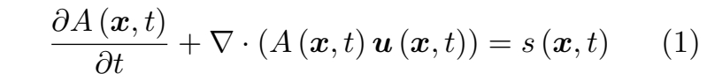
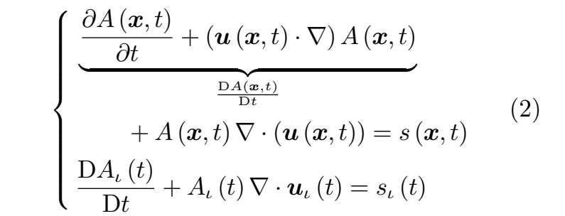
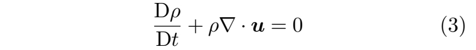
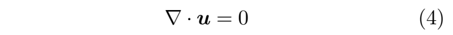
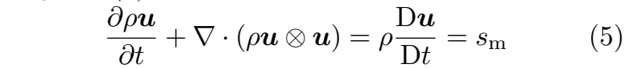
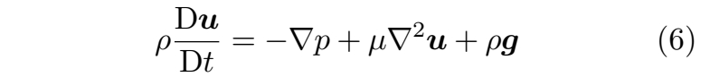

# 流体力学

流体力学将物体建模为物质在其体内**连续分布**的实体，称为**流体微团**。  

**连续性方程**描述了物理量在时空中的输运

   

其中：  
- **A** 可为任意标量、矢量或张量形式的物理属性，
- **u** 表示速度，
- **s** 是 **A** 的源项，
- 所有这些量均定义于时间 **t** 和位置 **x**。

公式 (1) 表明，在固定位置处任何物理属性的变化率 **∂A/∂t** 取决于 **Au** 通量所带来的变化以及源项 **s** 的贡献。

针对公式 (1) 中的物理属性 **A**，流场可从拉格朗日或欧拉视角进行分析：

**欧拉视角** 基于固定位置来研究物理属性的变化。在给定位置 **x** 处物理量 **A** 的变化率即为公式 (1) 中的 **∂A(x, t)/∂t** 项。虽然直观，但这一视角并未显式表达连续介质假设中流体微团的运动，因为微团始终在不同时刻流经固定的空间位置。

**拉格朗日视角** 通过将公式 (1) 改写为以下形式，研究流体微团的物理属性变化：    

   

其中 **D(·)/Dt** 即所谓的**物质导数**，表示流体微团内物理量 **A** 的变化率。

# **纳维-斯托克斯方程** 

**纳维-斯托克斯方程**描述了流体流动的动力学规律，是流体仿真的根本基础。

## **质量守恒**

在封闭系统中，流体的质量随时间保持守恒。该原理由连续性方程（公式（2））表示。令 **A** 为流体密度，并设 **s ≡ 0**，则公式（2）可改写为：   

   

在不可压缩流动的情况下，流体内的密度变化保持恒定，即 **Dρ/Dt = 0**。该条件进一步意味着速度场**无散度**，其表达式为：  

   

## **纳维-斯托克斯动量方程**

为进一步描述不可压缩流体流动的运动特性，可对每个流体微团的动量进行分析。将动量项 **ρu** 代入公式（1），并利用公式（2），可得：  

   

其中 **sm** 是改变各流体微团速度的**动量源项**，符号 **⊗** 表示**外积运算**。在此基础上，**黏性可压缩流**的纳维-斯托克斯动量方程基本形式进一步将 **sm** 具体表述为三个独立项：   

   

其中 **p** 表示**压力**，**g** 为**重力加速度**，**µ** 是描述流体粘性程度的**动态粘性系数**。公式（6）表明，流体微团的速度变化率受三个力项的影响：**压力项（−∇p）**、**粘性项（µ∇2u）** 以及**重力项（ρg）**。

# **从 NS 到浅水方程**

纳维-斯托克斯方程是三维流场的完整描述，但直接求解代价很高。**浅水方程（Shallow Water Equations）**是它针对「薄层流体」的一种近似降维：假设流动发生在薄层内（水平尺度 ≫ 深度），把三维问题压缩成「每个位置一个高度 + 一个水平平均速度」。它不是新物理，而是 NS 方程在特定假设下的严格推论。

## 核心假设：静水压强分布

对 NS 方程做降维的关键一步，是给压强 **p** 一个可积分的形式。完整 NS 里压强是未知场（要靠泊松方程解出来）；浅水近似假设：

**压强只由该点到水面的距离决定**——某点承受的只是「从它到水面之间那一段水的重量」，水平方向压强处处一致：

$$
p(x, z) = \rho g \,\big(s(x) - z\big)
$$

其中 **s(x)** 是水面高度，**z** 是该点的竖直坐标（向上为正）。这个假设的物理依据是：竖直方向上流体处于（近似）静力平衡，NS 竖直分量的重力项与压强梯度项相消。

> ✅ 这一步正是「让积分能算」的开关：压强不再是未知量，而是高度 s 的已知函数。NS 中最难解的部分（压强泊松方程）被一个代数式替代了。

## 压强项的水平梯度：沿深度积分

有了 p 的表达式，就可以计算 NS 水平分量的压强项。对一段水深（从底 b 到水面 s）积分：

$$
\int_b^{s} \frac{\partial p}{\partial x}\, dz \;=\; \int_b^{s} \rho g \frac{\partial s}{\partial x}\, dz \;=\; \rho g (s - b)\,\frac{\partial s}{\partial x}
$$

令水深 **h = s − b**，除以 h 得到深度平均后的水平压强梯度：

$$
\frac{1}{h}\int_b^{s} \frac{\partial p}{\partial x}\, dz \;=\; \rho g \frac{\partial s}{\partial x}
$$

注意结果的形态：**压强梯度只依赖水面坡度 ∂s/∂x，与压强在深度内怎么分布无关**（静水压线性分布的积分恰好抵消成均匀项）。这就是「薄层流动里水从高处往低处加速」的数学表述——驱动力正比于水面斜率。

## 浅水方程组

把深度平均后的质量守恒与动量守恒写在一起（忽略粘性与柯氏力）：

$$
\frac{\partial h}{\partial t} + \frac{\partial (h\bar{u})}{\partial x} = 0
\qquad\qquad
\frac{\partial \bar{u}}{\partial t} + \bar{u}\frac{\partial \bar{u}}{\partial x} = -g\frac{\partial s}{\partial x}
$$

- **第一个方程（质量/体积守恒）**：水柱高度的变化 = 净流入量，h·ū 是单位宽度截面的体积通量；
- **第二个方程（动量守恒）**：水平平均速度 ū 的变化由水面坡度驱动，ū·∂ū/∂x 是平流项（水带着自己的速度流动）；
- **s = b + h**：若底面平坦（b 常数），∂s/∂x = ∂h/∂x，方程组完全以 h 和 ū 为未知量封闭。

与完整 NS 对比，损失的只有三样：竖直方向的结构（速度剖面被压平为 ū）、竖直加速度（自由面不再翻卷）、以及垂向压强的非静水分量（快速流动时误差来源）。换来的代价优势是：未知量从 4 个三维场（u, v, w, p）降到 2 个一维场（h, ū），且**无需解压强泊松方程**。

## 与本课程高度场章节的关系

[高度场模型](../10_wave_height_feild.md) 求解的就是这套浅水方程：其「高度场更新」对应第一个方程，「速度场更新」对应第二个方程（课程版本忽略了平流项并消去 ū，得到单个二阶波动方程 d²h/dt² = (h/ρ)·∂²P/∂x² 的简化形式，便于引入空间离散化）。两处方程的差异只是「是否保留平流」的课程简化，物理假设同源：**静水压分布 + 薄层深度平均**。

# **从连续统到动理学**

以上讨论全部建立在**连续介质假设**之上：流体被建模为连续分布的**流体微团**，未知量是密度 **ρ(x, t)** 与速度 **u(x, t)** 这类**宏观量**，演化方程是 Navier-Stokes 方程。

若把观察层级下移一层，流体由大量分子构成，每个分子有自己的位置与速度。此时可以用**速度分布函数**描述流体：

\\[f(\mathbf{x}, \boldsymbol{\xi}, t)\\]

它的含义是：在时刻 **t**、位置 **x** 附近单位体积内，速度落在 **ξ** 附近单位速度区间内的分子数。与连续统描述相比，它多保留了一个**速度维度**的自变量。

宏观量是分布函数的**矩**：

\\[\rho = \int f \, d\boldsymbol{\xi}, \qquad \rho\mathbf{u} = \int \boldsymbol{\xi} f \, d\boldsymbol{\xi}\\]

也就是说，**只要知道 f，Navier-Stokes 方程中的宏观量都能由积分得到**。这一步是动理学与连续统之间的接口。

**f** 的演化由**玻尔兹曼输运方程**给出：

\\[\frac{\partial f}{\partial t} + \boldsymbol{\xi}\cdot\nabla_{\mathbf{x}} f = \Omega(f)\\]

- 左端对应分子在无碰撞情况下的**自由飞行**；
- 右端 **Ω(f)** 是**碰撞算子**，描述分子间碰撞引起的分布变化。

碰撞不产生也不消灭质量与动量，因此 **Ω(f)** 关于 **ξ** 的零阶矩与一阶矩均为零。对玻尔兹曼方程两端关于 **ξ** 取矩，即可得到宏观的连续性方程与动量方程——这是"从动理学还原到连续统"的基本途径。完整推导还需要配合 **Chapman-Enskog 展开**：把 **f** 按小参数展开并逐阶分离，零阶给出无粘的欧拉方程，一阶给出粘性应力张量，二阶还原出完整的 Navier-Stokes 方程。

完整碰撞算子是复杂的积分，工程上常用 **BGK 近似**（Bhatnagar-Gross-Krook, 1954）：

\\[\Omega(f) \approx -\frac{1}{\tau}\left(f - f^{eq}\right)\\]

即分布 **f** 以时间常数 **τ** 松弛到局部平衡分布 **f^eq**：

- **τ** 大 → 松弛慢 → 粘性大
- **τ** 小 → 松弛快 → 粘性小

这一近似把碰撞算子从积分运算简化为一次代数插值，是后面格子玻尔兹曼方法能够高效实现的关键。

### 三层描述对照

| 层级 | 描述变量 | 演化方程 | 对应方法 |
|---|---|---|---|
| 连续统（宏观）| \\(\rho, \mathbf{u}\\) | Navier-Stokes | 有限差分 / 有限体积 / 有限元 + 投影法 |
| 动理学（介观）| \\(f(\mathbf{x},\boldsymbol{\xi},t)\\) | 玻尔兹曼输运方程 + BGK | 格子玻尔兹曼方法 LBM |
| 分子（微观）| 每个分子的位置与速度 | 牛顿第二定律 | 分子动力学 MD |

本节内容属于**物理基础**，只说明动理学的描述层级与它和连续统的还原关系。对应的数值离散方案（格子气自动机与格子玻尔兹曼方法）见 [格子动理学方法](../Lattice/LatticeKinetic.md)，其中 [动理学基础](../Lattice/Boltzmann.md) 一节给出了本节内容的完整推导。

---------------------------------------
> 本文出自CaterpillarStudyGroup，转载请注明出处。
>
> https://caterpillarstudygroup.github.io/GAMES103_mdbook/